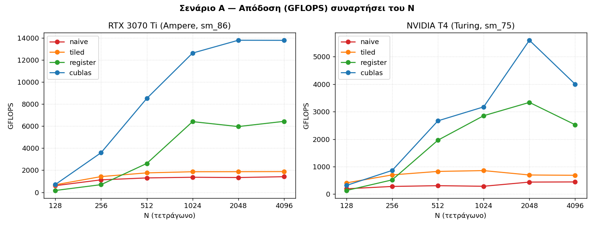
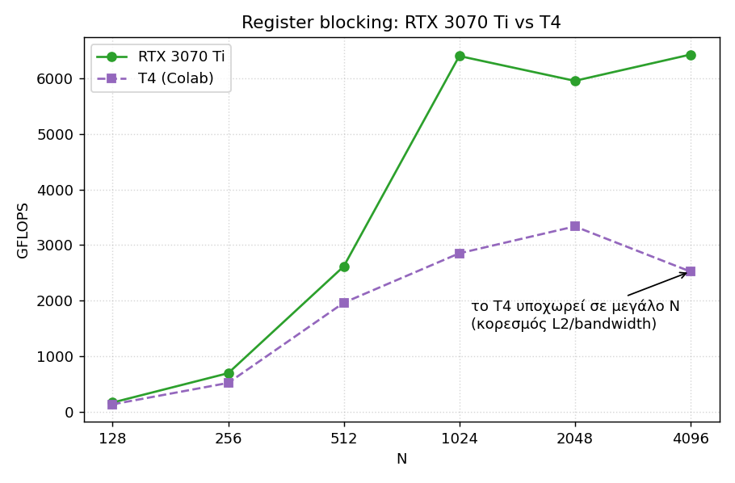
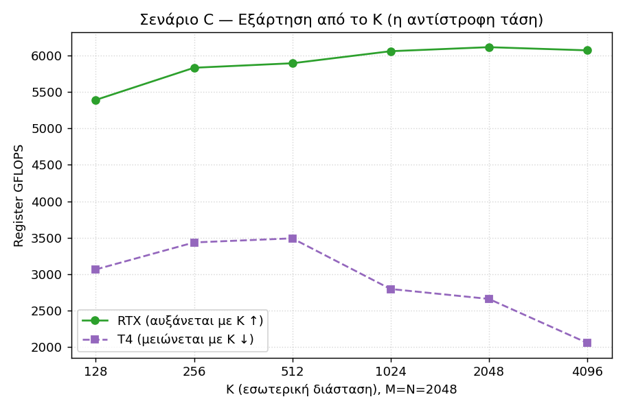
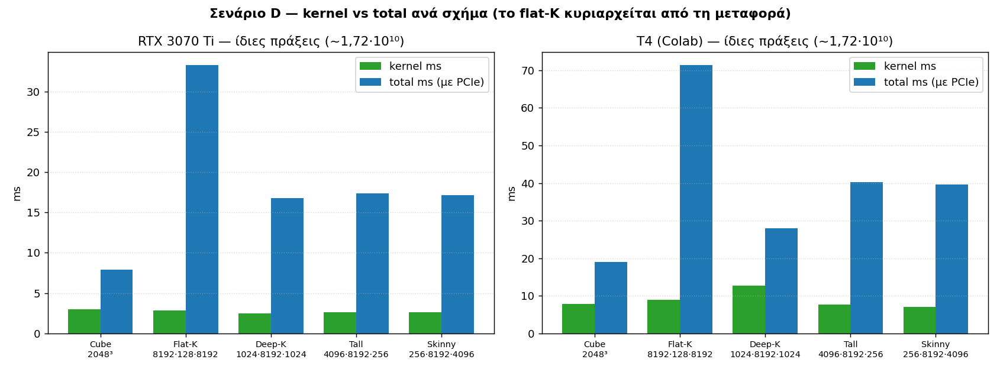
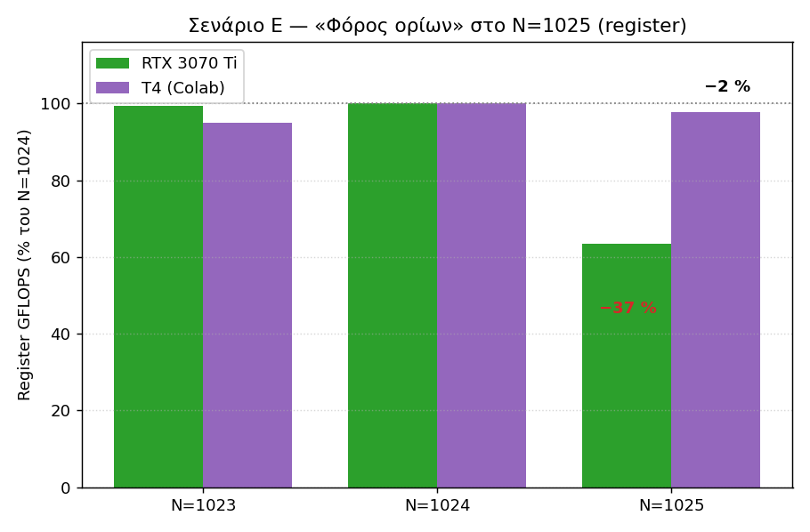

# Βελτιστοποίηση Επιδόσεων και Κλιμάκωσης Πολλαπλασιασμού Πίνακα × Πίνακα σε GPU με CUDA

**Χαροκόπειο Πανεπιστήμιο — Τμήμα Πληροφορικής και Τηλεματικής**
Σύγχρονες Παράλληλες Αρχιτεκτονικές και Προγραμματισμός Υψηλής Απόδοσης — Ακαδ. έτος 2025-2026
2η Εξαμηνιαία Εργαστηριακή Άσκηση

---

## Περίληψη

Υλοποιήθηκαν **τρεις διαφορετικοί αλγόριθμοι** πολλαπλασιασμού πίνακα × πίνακα (GEMM, C = A·B)
σε CUDA, σχεδιασμένοι ώστε ο καθένας να αξιοποιεί ένα βαθύτερο επίπεδο της **ιεραρχίας μνήμης**
της αρχιτεκτονικής NVIDIA GPU (Διαγράμματα 1 & 2):

1. **Naive** — μόνο Global Memory.
2. **Tiled** — Shared Memory.
3. **Register Blocking** — Shared Memory + Registers.

Ως σημείο αναφοράς (gold standard) χρησιμοποιήθηκε η βιβλιοθήκη **cuBLAS** της NVIDIA.

**Κύρια πλατφόρμα της μελέτης** — σύμφωνα με την εκφώνηση («υλοποίηση σε περιβάλλον Colab») — είναι
η **NVIDIA Tesla T4** (αρχιτεκτονική **Turing**, compute capability 7.5), σε **Google Colab**. Όλη η
ανάλυση των αποτελεσμάτων παρακάτω αφορά πρωτίστως το T4.

Ως **bonus**, ο **ίδιος** κώδικας εκτελέστηκε και σε τοπικό σύστημα με **NVIDIA GeForce RTX 3070 Ti**
(αρχιτεκτονική **Ampere**, compute capability 8.6), για επαλήθευση και σύγκριση αρχιτεκτονικών.

Η ορθότητα επιβεβαιώθηκε σε κάθε εκτέλεση (σύγκριση με cuBLAS και με υπολογισμό στη CPU) και η
απόδοση μετρήθηκε για μεγέθη N = 128 … 9000 και για ορθογώνιους πίνακες. Τα αποτελέσματα στο **T4**
επιβεβαιώνουν ότι η σταδιακή αξιοποίηση της ιεραρχίας μνήμης αυξάνει το *arithmetic intensity* και
την απόδοση (Naive → Tiled → Register Blocking· ο register blocking είναι έως **~7,6×** ταχύτερος από
τον naive στην κορυφή του, N=2048). Η bonus σύγκριση με την RTX δείχνει επιπλέον ότι η βέλτιστη στρατηγική **εξαρτάται από τη
GPU** (βλ. Παραδοτέο ΙΙΙ, §5 «Bonus»).

---

# ΠΑΡΑΔΟΤΕΟ Ι — Περιγραφή αλγορίθμων με βάση την αρχιτεκτονική (30%)

## 1. Η αρχιτεκτονική NVIDIA GPU και το μοντέλο CUDA

### 1.1 Δομή υλικού (Διάγραμμα 1)

Η GPU οργανώνεται ιεραρχικά:

- **SP (Streaming Processor / CUDA core):** η στοιχειώδης αριθμητική μονάδα (ALU) που εκτελεί
  μία πράξη κινητής υποδιαστολής ανά κύκλο.
- **SM (Streaming Multiprocessor):** ομαδοποιεί πολλά SP μαζί με κοινές μονάδες ελέγχου (warp
  schedulers), αρχείο καταχωρητών (register file) και **Shared Memory**. Είναι η μονάδα που
  εκτελεί τα *blocks*.
- **Κοινές μονάδες ελέγχου → μοντέλο SIMT** (Single Instruction, Multiple Threads): μία εντολή
  εκδίδεται ταυτόχρονα σε **32 νήματα** (ένα *warp*) που εκτελούνται σε lockstep. Συνέπεια: αν τα
  νήματα ενός warp ακολουθήσουν διαφορετικό κλάδο σε ένα `if` (*warp divergence*), οι κλάδοι
  σειριοποιούνται.

### 1.2 Ιεραρχία μνήμης — το κλειδί της βελτιστοποίησης

| Μνήμη | Εμβέλεια | Λανθάνων χρόνος | Μέγεθος | Διαχείριση |
|---|---|---|---|---|
| Registers | ανά νήμα | ~1 κύκλος | πολύ μικρό | μεταγλωττιστής |
| Shared Memory / L1 | ανά block (στο SM) | ~20–30 κύκλοι | ~48–164 KB/SM | **προγραμματιστής** |
| L2 Cache | όλα τα SM | ~200 κύκλοι | MB | υλικό |
| Global Memory (DRAM/HBM) | όλη η GPU | ~400–800 κύκλοι | GB | υλικό |

Η Global Memory έχει μεγάλο εύρος ζώνης αλλά **πολύ μεγάλο λανθάνοντα χρόνο** και αποτελεί τη
βασική «στενωπό». Όλη η τέχνη της βελτιστοποίησης GEMM συνοψίζεται στο εξής: *φέρε ένα δεδομένο
μία φορά από τη Global Memory και επαναχρησιμοποίησέ το όσο το δυνατόν περισσότερες φορές από τη
Shared Memory και τους Registers*.

### 1.3 Μοντέλο Host / Device (Διάγραμμα 2)

- **Host** = CPU + Main Memory. **Device** = GPU + Global Memory.
- Συνδέονται με δίαυλο PCIe. Τα δεδομένα μεταφέρονται host→device (`cudaMemcpy`) πριν τον
  υπολογισμό και device→host μετά. Η μεταφορά αυτή είναι αργή σε σχέση με τον υπολογισμό, γι' αυτό
  στις μετρήσεις χρονομετράμε **μόνο τον kernel** (όχι τις μεταφορές).
- Ο κώδικας του kernel εκτελείται στο device, με ιεραρχία νημάτων: **thread → block → grid**, που
  αντιστοιχίζεται στο υλικό ως **SP → SM → GPU**. Η μονάδα χρονοδρομολόγησης είναι το **warp**
  (32 νήματα).

### 1.4 Οι δύο αρχιτεκτονικές της μελέτης (Turing vs Ampere)

Η περιγραφή των Διαγραμμάτων 1 & 2 υλοποιείται διαφορετικά σε κάθε γενιά GPU. Επιλέξαμε δύο
αντιπροσωπευτικές αρχιτεκτονικές ώστε τα συμπεράσματα να μην είναι «δεμένα» σε μία μόνο GPU:

| Χαρακτηριστικό | NVIDIA T4 (Turing) | RTX 3070 Ti (Ampere) |
|---|---|---|
| Compute capability | 7.5 | 8.6 |
| Streaming Multiprocessors (SM) | 40 | 48 |
| Κορυφή FP32 (θεωρητική) | ~8,1 TFLOPS | ~21,7 TFLOPS |
| Εύρος ζώνης μνήμης | ~320 GB/s | ~608 GB/s |
| L2 Cache | 4 MB | 6 MB |
| Global Memory | 16 GB GDDR6 | 8 GB GDDR6X |
| Περιβάλλον | Google Colab | τοπικό σύστημα |

Οι διαφορές αυτές (αριθμός SM → διαθέσιμη παραλληλία· bandwidth & L2 → ικανότητα τροφοδοσίας
δεδομένων) δεν είναι ακαδημαϊκές: όπως δείχνει το Παραδοτέο ΙΙΙ, **εξηγούν άμεσα** γιατί ο ίδιος
αλγόριθμος συμπεριφέρεται διαφορετικά στις δύο GPU (π.χ. το T4 με λιγότερα SM και μικρότερη L2
κορεσμένει νωρίτερα, ενώ η RTX διατηρεί την απόδοση σε μεγαλύτερη κλίμακα).

## 2. Το πρόβλημα GEMM και το arithmetic intensity

Για C(N×N) = A(N×N)·B(N×N):

$$C_{ij} = \sum_{k=0}^{N-1} A_{ik}\,B_{kj}$$

- **Πράξεις:** 2·N³ (ένας πολλαπλασιασμός + μία πρόσθεση ανά όρο).
- **Δεδομένα:** 3·N² στοιχεία.

Επειδή ο όγκος υπολογισμού (O(N³)) είναι κατά τάξη μεγαλύτερος από τον όγκο δεδομένων (O(N²)),
**κάθε στοιχείο μπορεί να επαναχρησιμοποιηθεί έως N φορές**. Ο βαθμός στον οποίο κάθε αλγόριθμος
εκμεταλλεύεται αυτή την επαναχρησιμοποίηση καθορίζεται από το **arithmetic intensity** (AI = πράξεις
ανά byte που διαβάζεται από μνήμη). Χαμηλό AI → *memory-bound*· υψηλό AI → *compute-bound*. Οι τρεις
αλγόριθμοι διαφέρουν ακριβώς στο AI που πετυχαίνουν.

## 3. Αλγόριθμος 1 — Naive (μόνο Global Memory)

Κάθε νήμα υπολογίζει **ένα** στοιχείο C[row][col], διαβάζοντας μια ολόκληρη γραμμή του A και μια
στήλη του B απευθείας από τη Global Memory:

```cuda
int row = blockIdx.y*blockDim.y + threadIdx.y;
int col = blockIdx.x*blockDim.x + threadIdx.x;
float sum = 0.f;
for (int k = 0; k < N; ++k)
    sum += A[row*N + k] * B[k*N + col];
C[row*N + col] = sum;
```

- **Αντιστοιχία αρχιτεκτονικής:** χρησιμοποιεί μόνο το κατώτατο επίπεδο της ιεραρχίας (Global Memory).
- **Επαναχρησιμοποίηση:** καμία· κάθε στοιχείο των A, B ξαναδιαβάζεται από τη Global Memory.
  Συνολικά O(N³) προσβάσεις, AI ≈ 0,25 flop/byte → **έντονα memory-bound**.
- Οι προσβάσεις στον B είναι *coalesced* (διαδοχικές διευθύνσεις ανά warp, αφού το `threadIdx.x`
  αντιστοιχεί στη στήλη), ενώ η τιμή A[row·N+k] είναι κοινή (broadcast) στο warp. Το L2 cache
  ανακτά μέρος της επαναχρησιμοποίησης, γι' αυτό ο naive πιάνει αρκετές εκατοντάδες GFLOPS παρά τη
  θεωρητικά πολύ χαμηλή του ένταση.

## 4. Αλγόριθμος 2 — Tiled / Blocked (Shared Memory)

Κάθε block φορτώνει υπο-πίνακες (tiles) μεγέθους TILE×TILE των A και B στη **Shared Memory** και τα
επαναχρησιμοποιεί:

```cuda
__shared__ float As[TILE][TILE], Bs[TILE][TILE];
for (int t = 0; t < N/TILE; ++t) {
    As[ty][tx] = A[...];   Bs[ty][tx] = B[...];   // φόρτωση tile
    __syncthreads();                              // φράγμα: γέμισαν όλοι
    for (int k = 0; k < TILE; ++k)
        sum += As[ty][k] * Bs[k][tx];             // υπολογισμός από shared
    __syncthreads();                              // πριν ξαναγραφτούν τα tiles
}
```

- **Αντιστοιχία αρχιτεκτονικής:** αξιοποιεί τη Shared Memory κάθε SM ως διαχειριζόμενη από τον
  προγραμματιστή cache.
- **Ιδέα:** κάθε στοιχείο φορτώνεται **μία φορά** από Global Memory και χρησιμοποιείται **TILE
  φορές** από τη Shared Memory → η κίνηση προς τη Global Memory μειώνεται κατά παράγοντα TILE και
  το AI αυξάνεται αναλόγως.
- Απαιτεί συγχρονισμό `__syncthreads()` ώστε όλα τα νήματα να ολοκληρώσουν τη φόρτωση πριν αρχίσει
  ο υπολογισμός.

## 5. Αλγόριθμος 3 — Register Blocking / Thread Coarsening (Shared + Registers)

Επέκταση του tiling με ένα δεύτερο επίπεδο: κάθε block υπολογίζει ένα μπλοκ BM×BN, αλλά τώρα κάθε
**νήμα** υπολογίζει ένα υπο-μπλοκ TM×TN στοιχείων, κρατώντας τους **συσσωρευτές σε Registers**.
Σε κάθε βήμα φορτώνει TM τιμές του As και TN τιμές του Bs σε καταχωρητές και εκτελεί ένα
**εξωτερικό γινόμενο** (outer product):

```cuda
float acc[TM*TN] = {0};            // συσσωρευτές στους registers
for (κάθε φέτα BK κατά μήκος του K) {
    // συνεργατική φόρτωση tiles A (BM×BK) και B (BK×BN) στη shared
    for (int k = 0; k < BK; ++k) {
        load regM[TM] από As;  load regN[TN] από Bs;   // shared → registers
        for i in TM: for j in TN: acc[i][j] += regM[i]*regN[j];
    }
}
```

Με τις προεπιλεγμένες παραμέτρους (BM=BN=64, BK=8, TM=TN=8): 64 νήματα/block, **64 αποτελέσματα
ανά νήμα**.

- **Αντιστοιχία αρχιτεκτονικής:** αξιοποιεί **και τα τρία επίπεδα** της ιεραρχίας
  (Global → Shared → Registers).
- **Όφελος:** οι TM·TN τιμές επαναχρησιμοποιούνται από τους ταχύτατους καταχωρητές· κάθε φόρτωση
  από τη Shared Memory τροφοδοτεί TM+TN registers αλλά παράγει TM·TN πολλαπλασιασμούς → πολύ
  υψηλότερο AI και λιγότερο κόστος εντολών ανά πράξη. Έτσι λειτουργούν και οι πραγματικές
  βιβλιοθήκες υψηλής απόδοσης.
- **Κόστος:** μεγάλη κατανάλωση καταχωρητών ανά νήμα (*register pressure*) που μειώνει το
  *occupancy*, και πιο σύνθετος κώδικας.

## 6. Σημείο αναφοράς — cuBLAS

Η `cublasSgemm` της NVIDIA είναι η βιομηχανικά βελτιστοποιημένη υλοποίηση (register/warp tiling,
double buffering, βέλτιστη αξιοποίηση εύρους ζώνης). Χρησιμεύει ως «ταβάνι» επιδόσεων και ως
αναφορά ορθότητας. (Σημ.: η cuBLAS είναι *column-major*· για row-major δεδομένα την καλούμε με
εναλλαγμένους τελεστές, ώστε να υπολογίζει Cᵀ = Bᵀ·Aᵀ.)

---

# ΠΑΡΑΔΟΤΕΟ ΙΙ — Κώδικας CUDA (40%)

## Δομή

Ο κώδικας παραδίδεται σε **τρία αυτόνομα αρχεία**, ένα ανά αλγόριθμο, καθένα με δικό του
πρόγραμμα μέτρησης και έλεγχο ορθότητας:

| Αρχείο | Αλγόριθμος | Επίπεδο μνήμης |
|---|---|---|
| `gemm_naive.cu` | Naive | Global |
| `gemm_tiled.cu` | Tiled | Shared |
| `gemm_register.cu` | Register Blocking | Shared + Registers |

Κάθε αρχείο περιλαμβάνει: τον kernel, υπολογισμό αναφοράς στη CPU, σύγκριση με cuBLAS, μέτρηση
χρόνου με **CUDA events**, υπολογισμό **GFLOPS**, και αυτόματη κλιμάκωση των μεγεθών. Όλοι οι
kernels διαχειρίζονται σωστά διαστάσεις που **δεν** είναι ακέραια πολλαπλάσια του tile (έλεγχος
ορίων στις φορτώσεις/εγγραφές) και υποστηρίζουν **ορθογώνιους** πίνακες A(M×K)·B(K×N) μέσω της
επιλογής `-r M K N`.

**Σημαντικό:** ο **ίδιος** κώδικας μεταγλωττίστηκε και εκτελέστηκε **και στις δύο αρχιτεκτονικές**,
αλλάζοντας μόνο την παράμετρο `-arch` ώστε να ταιριάζει στο compute capability της εκάστοτε GPU.

## Μεταγλώττιση & εκτέλεση (και στις δύο αρχιτεκτονικές)

**(α) NVIDIA T4 — Turing (sm_75), σε Google Colab με GPU runtime:**

```bash
!nvcc -O3 -arch=sm_75 gemm_naive.cu    -o naive -lcublas && ./naive
!nvcc -O3 -arch=sm_75 gemm_tiled.cu    -o tiled -lcublas && ./tiled
!nvcc -O3 -arch=sm_75 gemm_register.cu -o reg   -lcublas && ./reg
```

**(β) NVIDIA RTX 3070 Ti — Ampere (sm_86), σε τοπικό σύστημα:**

```bash
nvcc -O3 -arch=sm_86 gemm_naive.cu    -o naive -lcublas && ./naive
nvcc -O3 -arch=sm_86 gemm_tiled.cu    -o tiled -lcublas && ./tiled
nvcc -O3 -arch=sm_86 gemm_register.cu -o reg   -lcublas && ./reg
```

| GPU | Αρχιτεκτονική | flag `-arch` |
|---|---|---|
| Tesla T4 | Turing | `sm_75` |
| RTX 3070 Ti | Ampere | `sm_86` |
| A100 | Ampere | `sm_80` |
| V100 | Volta | `sm_70` |

Προαιρετικά ορίσματα: τετράγωνα μεγέθη (`./naive 512 1024 2048 4096`) ή ορθογώνιο (`./naive -r 1024 512 2048`).
Το πρόγραμμα ανιχνεύει αυτόματα και τυπώνει το όνομα/χαρακτηριστικά της GPU στην οποία τρέχει.

> ⚠️ **ΟΔΗΓΙΑ (αφαιρέστε πριν την παράδοση):** Τα πλαίσια «📸 SCREENSHOT» σε όλη την αναφορά δείχνουν
> πού πρέπει να μπει στιγμιότυπο οθόνης με το output. Για κάθε ένα: τρέξε την αναγραφόμενη **εντολή/cell**
> στο αναγραφόμενο **περιβάλλον**, τράβα screenshot, και αντικατέστησε το πλαίσιο με την εικόνα.

> 📸 **SCREENSHOT 1 — Επιβεβαίωση GPU (Colab, T4)**
> **Περιβάλλον:** Google Colab (Runtime → GPU). **Εντολή (code cell):**
> ```python
> !nvidia-smi
> ```
> **Τι να φαίνεται:** το όνομα της GPU «Tesla T4» και η έκδοση CUDA — αποδεικνύει ότι τρέχει σε T4.

> 📸 **SCREENSHOT 2 — Μεταγλώττιση & εκτέλεση στο T4 (Colab, Turing/sm_75)**
> **Περιβάλλον:** Google Colab. **Εντολή (code cell):**
> ```python
> !nvcc -O3 -arch=sm_75 gemm_naive.cu -o naive -lcublas
> !./naive
> ```
> **Τι να φαίνεται:** η γραμμή «=== [NAIVE] GPU: Tesla T4 … ===» και ο πίνακας αποτελεσμάτων με τη
> στήλη **check = OK** σε όλες τις γραμμές (αποδεικνύει σωστή μεταγλώττιση + ορθότητα).

> 📸 **SCREENSHOT 3 — Μεταγλώττιση & εκτέλεση στην RTX 3070 Ti (τοπικό, Ampere/sm_86)**
> **Περιβάλλον:** τοπικό τερματικό (bash). **Εντολή:**
> ```bash
> nvcc -O3 -arch=sm_86 gemm_naive.cu -o naive -lcublas && ./naive
> ```
> **Τι να φαίνεται:** η γραμμή «=== [NAIVE] GPU: NVIDIA GeForce RTX 3070 Ti … ===» με τον πίνακα και
> check = OK — αποδεικνύει εκτέλεση στη **δεύτερη αρχιτεκτονική**.

## Δεδομένα εισόδου (περιεχόμενο των πινάκων)

Οι πίνακες A και B γεμίζουν με **ψευδοτυχαίες τιμές κινητής υποδιαστολής στο διάστημα [0, 1]**:

```c
for (i = 0; i < M*K; ++i) hA[i] = (float)rand() / RAND_MAX;   // A: M×K
for (i = 0; i < K*N; ++i) hB[i] = (float)rand() / RAND_MAX;   // B: K×N
```

Ο πίνακας C προκύπτει από τον υπολογισμό. Σχεδιαστικές επιλογές και ο λόγος τους:

- **Τυχαίοι, όχι hardcoded:** αποφεύγουμε «ειδικές» τιμές (π.χ. μηδενικά ή μονάδες) που θα μπορούσαν
  να κρύψουν σφάλματα ευθυγράμμισης/ορίων ή να ευνοήσουν τεχνητά τον υπολογισμό.
- **Ντετερμινιστικοί (χωρίς `srand`):** η `rand()` παράγει την **ίδια ακολουθία σε κάθε εκτέλεση**.
  Έτσι όλοι οι αλγόριθμοι και η cuBLAS συγκρίνονται στα **ακριβώς ίδια δεδομένα**, και τα πειράματα
  είναι **αναπαραγώγιμα** (ίδιοι πίνακες σε κάθε run).
- **Οι τιμές δεν επηρεάζουν τον χρόνο:** ο GEMM εκτελεί τις ίδιες 2·M·K·N πράξεις ανεξαρτήτως
  περιεχομένου· οι τιμές μετρούν **μόνο για τον έλεγχο ορθότητας**. Άρα η σύγκριση επιδόσεων είναι
  δίκαιη ανεξαρτήτως της συγκεκριμένης τυχαίας εισόδου.
- **Εύρος [0, 1]:** κρατά φραγμένο το μέγεθος των μερικών αθροισμάτων ακόμη και για μεγάλο K,
  περιορίζοντας τη συσσώρευση σφάλματος FP32 και διατηρώντας τον έλεγχο ορθότητας αξιόπιστο.

(Αν χρειαζόταν διαφορετική είσοδος σε κάθε εκτέλεση, θα αρκούσε ένα `srand(time(NULL))`· εδώ
προτιμήθηκε η σταθερή είσοδος για συγκρισιμότητα.)

## Μεθοδολογία μέτρησης

- **Warm-up:** 2 εκτελέσεις πριν τη μέτρηση (αποφυγή κόστους αρχικοποίησης / JIT).
- **Μέσος όρος:** 5 επαναλήψεις.
- Χρονομετράται **μόνο ο kernel** με `cudaEvent` (ο καθαρός υπολογισμός), ενώ ξεχωριστά μετράται και
  το **end-to-end (total)** = H2D (A,B) + kernel + D2H (C), ώστε να φαίνεται και το κόστος του PCIe.
- **GFLOPS** = 2·M·K·N / (χρόνος_sec) / 10⁹.
- **Έλεγχος ορθότητας:** μέγιστο σχετικό σφάλμα ως προς cuBLAS (και CPU για μικρά μεγέθη)· κατώφλι
  επιτυχίας 10⁻² (λόγω συσσώρευσης σφαλμάτων FP32). Όλες οι μετρήσεις σημειώθηκαν **OK**.

---

# ΠΑΡΑΔΟΤΕΟ ΙΙΙ — Αποτελέσματα και ανάλυση (30%)

## 1. Πίνακες αποτελεσμάτων

> **Κύρια πλατφόρμα: NVIDIA T4 (Google Colab).** Οι πίνακες §1.1–§1.2 και όλη η κύρια ανάλυση
> αφορούν το T4. Οι πίνακες της RTX 3070 Ti (§1.3–§1.4) δίνονται ως **bonus** για σύγκριση.

### 1.1 NVIDIA T4 (Google Colab) — απόδοση σε GFLOPS

| N | Naive | Tiled | Register | cuBLAS |
|---|---|---|---|---|
| 256 | 280,2 | 700,2 | 518,6 | 862,3 |
| 512 | 307,8 | 826,9 | 1962,2 | 2666,4 |
| 1024 | 286,9 | 856,3 | 2852,5 | 3173,6 |
| 2048 | 438,6 | 696,8 | 3337,0 | 5597,7 |
| 4096 | 444,8 | 685,5 | 2524,7 | 4000,1 |

### 1.2 NVIDIA T4 — χρόνος εκτέλεσης (ms)

| N | Naive | Tiled | Register | cuBLAS |
|---|---|---|---|---|
| 256 | 0,120 | 0,048 | 0,065 | 0,039 |
| 512 | 0,872 | 0,325 | 0,137 | 0,101 |
| 1024 | 7,486 | 2,508 | 0,753 | 0,677 |
| 2048 | 39,173 | 24,655 | 5,148 | 3,069 |
| 4096 | 308,992 | 200,482 | 54,438 | 34,358 |

**Αναλυτική ανάγνωση των αποτελεσμάτων του T4 (κύρια πλατφόρμα):**

- **Σταθερή κατάταξη στα ρεαλιστικά μεγέθη (N ≥ 512):** `cuBLAS > Register > Tiled > Naive`. Π.χ.
  στο N=2048 (GFLOPS): naive 439, tiled 697, register 3337, cuBLAS 5598. Κάθε «σκαλί» αντιστοιχεί σε
  βαθύτερη αξιοποίηση της ιεραρχίας μνήμης (Global → Shared → Registers).
- **Naive — δέσμιος του εύρους ζώνης:** η απόδοσή του «κολλάει» γύρω στα **~300–445 GFLOPS** ανεξάρτητα
  από το N (308 → 445 από 512 σε 4096). Αυτό είναι η υπογραφή ενός *memory-bound* πυρήνα: όση
  παραλληλία κι αν προσθέσουμε, τον φράζει το εύρος ζώνης της global memory (~320 GB/s στο T4).
- **Tiled — η shared memory ανεβάζει την απόδοση:** ~690–856 GFLOPS στο N≥1024, δηλαδή **~1,5–2×** τον
  naive. Η επαναχρησιμοποίηση μέσω shared memory μειώνει την κίνηση προς τη global κατά παράγοντα TILE.
- **Register Blocking — ανατρέπει την κατάταξη ανάλογα με το μέγεθος:** στα πολύ μικρά N είναι **ο πιο
  αργός** μας πυρήνας (133 GFLOPS στο N=128, πιο αργός κι από τον naive· 519 στο N=256, κάτω από τον
  tiled), επειδή τα μεγάλα tiles 64×64 αφήνουν λίγα blocks και αφήνουν τα 40 SM του T4 υποαπασχολημένα.
  Όμως από N≥1024 «εκτοξεύεται» (2853 → 3337 GFLOPS στο 1024→2048), φτάνοντας **~7,6×** τον naive στην
  κορυφή του (N=2048) — η ταχύτερη δική μας λύση. Στο N=4096 **υποχωρεί** στα 2525 (~5,7× naive), καθώς
  το T4 κορεσμένει σε μεγάλο working set.
- **Χρόνος εκτέλεσης (§1.2):** αυξάνεται **κυβικά** (×~8 ανά διπλασιασμό του N, αφού οι πράξεις είναι
  2·N³). Στο N=4096 ο naive χρειάζεται 309 ms, ο register μόλις 54 ms (~5,7× ταχύτερα), ενώ η cuBLAS 34 ms.
- **Απόσταση από τη cuBLAS:** ο καλύτερος δικός μας (register) απέχει ~1,1–1,7× από τη cuBLAS — η
  cuBLAS χρησιμοποιεί πιο προχωρημένες τεχνικές (double buffering, vectorized loads, βέλτιστο tuning).

### 1.3 (Bonus) NVIDIA RTX 3070 Ti — απόδοση σε GFLOPS

| N | Naive | Tiled | Register | cuBLAS |
|---|---|---|---|---|
| 256 | 1129,9 | 1424,7 | 694,2 | 3588,6 |
| 512 | 1304,2 | 1761,7 | 2617,0 | 8511,2 |
| 1024 | 1364,6 | 1863,5 | 6405,5 | 12618,2 |
| 2048 | 1339,0 | 1869,5 | 5958,2 | 13781,2 |
| 4096 | 1414,7 | 1878,5 | 6431,1 | 13773,5 |

### 1.4 (Bonus) NVIDIA RTX 3070 Ti — χρόνος εκτέλεσης (ms)

| N | Naive | Tiled | Register | cuBLAS |
|---|---|---|---|---|
| 256 | 0,030 | 0,024 | 0,048 | 0,009 |
| 512 | 0,206 | 0,152 | 0,103 | 0,032 |
| 1024 | 1,574 | 1,152 | 0,335 | 0,170 |
| 2048 | 12,830 | 9,190 | 2,883 | 1,247 |
| 4096 | 97,153 | 73,164 | 21,371 | 9,978 |

### 1.5 Επιτάχυνση ως προς τον Naive (στο N = 4096)

| GPU | Tiled / Naive | Register / Naive |
|---|---|---|
| T4 | 1,54× | **5,68×** |
| RTX 3070 Ti | 1,33× | **4,55×** |

## 2. Ανάλυση ανά αλγόριθμο

### 2.1 Naive
- **Συμπεριφορά:** η απόδοση παραμένει σχεδόν σταθερή με το N (T4: ~280→445 GFLOPS, RTX: ~1130→1415
  GFLOPS), δηλαδή ο αλγόριθμος «κορεσμένος» στο εύρος ζώνης της μνήμης — κλασική εικόνα
  **memory-bound** προβλήματος.
- **Πλεονεκτήματα:** απλούστατος, εύκολος στην επαλήθευση, καλό baseline· σωστά coalesced προσβάσεις
  στον B.
- **Μειονεκτήματα:** μηδενική επαναχρησιμοποίηση δεδομένων → σπαταλά το εύρος ζώνης· η πιο αργή λύση
  (έως ~13× πιο αργή από cuBLAS στην T4).

### 2.2 Tiled (Shared Memory)
- **Συμπεριφορά:** σταθερή βελτίωση ~1,4–1,8× έναντι του naive (T4: ~686, RTX: ~1879 GFLOPS στο
  4096). Η απόδοση ανεβαίνει ελαφρώς με το N καθώς το κόστος εκκίνησης αποσβένεται.
- **Πλεονεκτήματα:** σημαντική μείωση κίνησης Global Memory (×TILE)· σχετικά απλός κώδικας· καλή
  ισορροπία απόδοσης/πολυπλοκότητας.
- **Μειονεκτήματα:** κάθε νήμα εξακολουθεί να υπολογίζει μόλις ένα στοιχείο → το AI παραμένει
  περιορισμένο και απέχει αρκετά από το cuBLAS· η απόδοση εξαρτάται από την επιλογή του TILE και
  ευαισθητοποιείται σε *bank conflicts* της Shared Memory.

### 2.3 Register Blocking (Shared + Registers)
- **Συμπεριφορά:** η μεγαλύτερη κλιμάκωση με το μέγεθος. Στα μικρά N (128) είναι **αργός** (T4: 133,
  RTX: 166 GFLOPS) επειδή τα μεγάλα tiles 64×64 αφήνουν λίγα blocks → χαμηλό occupancy και
  ανεπαρκή «κάλυψη» του υλικού. Από N ≥ 1024 η απόδοση εκτοξεύεται (RTX: ~6400 GFLOPS, ~4,5×
  ταχύτερα από naive· T4: ~3300 GFLOPS στην κορυφή N=2048, έως ~7,6×).
- **Πλεονεκτήματα:** υψηλότατο arithmetic intensity, η ταχύτερη δική μας λύση, προσεγγίζει τη
  συμπεριφορά πραγματικής βιβλιοθήκης.
- **Μειονεκτήματα:** υψηλή κατανάλωση καταχωρητών (64 συσσωρευτές/νήμα) → περιορισμένο occupancy·
  πιο σύνθετος κώδικας· **κακή απόδοση σε μικρά προβλήματα** (overhead > όφελος).

### 2.4 cuBLAS (αναφορά)
- Η ταχύτερη σε όλες τις περιπτώσεις. Στην RTX 3070 Ti φτάνει ~13,8 TFLOPS (≈64% της θεωρητικής
  κορυφής ~21,7 TFLOPS FP32, και ~15,9 TFLOPS στο N=9000)· στην T4 ~5,6–6,6 TFLOPS (≈70–80% της κορυφής ~8,1 TFLOPS).
- **Παρατήρηση:** στην T4 η cuBLAS παρουσιάζει πτώση στο N=4096 (5598 → 4000 GFLOPS). Αυτό
  αποδίδεται σε εσωτερική επιλογή διαφορετικού αλγορίθμου/heuristic για το συγκεκριμένο μέγεθος και
  στους περιορισμούς εύρους ζώνης/θερμοκρασίας της T4 — υπενθυμίζει ότι ακόμη και οι βέλτιστες
  βιβλιοθήκες έχουν μη μονοτονική συμπεριφορά κατά την κλιμάκωση.

## 3. Σχεδιαστικές επιλογές (παράμετροι)

- **TILE = 16 (Tiled):** δίνει 256 νήματα/block (πολλαπλάσιο του warp), ισορροπώντας χρήση Shared
  Memory και occupancy. Μεγαλύτερο TILE αυξάνει την επαναχρησιμοποίηση αλλά καταναλώνει περισσότερη
  Shared Memory ανά block, μειώνοντας τα ταυτόχρονα ενεργά blocks.
- **BM=BN=64, BK=8, TM=TN=8 (Register):** κάθε νήμα παράγει 8×8=64 αποτελέσματα. Η επιλογή
  μεγιστοποιεί την επαναχρησιμοποίηση στους καταχωρητές, με αντίτιμο register pressure — εξηγεί
  την υστέρηση στα μικρά N και την υπεροχή στα μεγάλα.
- **block 2D με `threadIdx.x` → στήλη:** εξασφαλίζει coalesced προσβάσεις και στους τρεις kernels.

## 4. Επίδραση της κλιμάκωσης (μέγεθος → χρόνος)

- Ο χρόνος εκτέλεσης αυξάνεται περίπου **κυβικά** (×8 ανά διπλασιασμό του N), όπως αναμένεται από
  την πολυπλοκότητα O(N³): π.χ. στον naive (RTX) 12,8 ms → 97,2 ms από N=2048 σε N=4096 (×7,6).
- Τα GFLOPS των βελτιστοποιημένων αλγορίθμων **αυξάνονται με το N**, καθώς μεγαλύτερα προβλήματα
  παρέχουν περισσότερη παραλληλία και καλύτερη απόσβεση των σταθερών επιβαρύνσεων — άρα η GPU
  αξιοποιείται πληρέστερα όσο μεγαλώνει η κλίμακα.
- Η σχετική διαφορά (gap) από τη cuBLAS μικραίνει με την αύξηση του N για τον register blocking,
  επιβεβαιώνοντας ότι οι τεχνικές αυτές «ανταμείβονται» σε προβλήματα μεγάλης κλίμακας — ακριβώς
  το σενάριο των εφαρμογών Deep Learning και LLMs.

## 5. Εκτεταμένα πειράματα: σενάρια και αναλυτικά συμπεράσματα (κύρια πλατφόρμα: T4)

Για βαθύτερη ανάλυση εκτελέστηκε κάθε αλγόριθμος πολλές φορές, σε πέντε ομάδες πειραμάτων (Σενάρια
A–E) που απομονώνουν διαφορετικές παραμέτρους. Όλες οι μετρήσεις πέρασαν τον έλεγχο ορθότητας (OK).
**Οι πίνακες και η ανάλυση που ακολουθούν αφορούν την κύρια πλατφόρμα, το NVIDIA T4 (Colab).** Στο
τέλος της ενότητας, ως **Bonus**, δίνεται η σύγκριση με την RTX 3070 Ti και τα διαγράμματα.

### Σενάριο A — Κλιμάκωση τετράγωνων (N = 128 … 4096) στο T4, GFLOPS

| N | Naive | Tiled | Register | cuBLAS |
|---|---|---|---|---|
| 128 | 194,6 | 409,6 | 133,2 | 317,4 |
| 256 | 280,2 | 700,2 | 518,6 | 862,3 |
| 512 | 307,8 | 826,9 | 1962,2 | 2666,4 |
| 1024 | 286,9 | 856,3 | 2852,5 | 3173,6 |
| 2048 | 438,6 | 696,8 | 3337,0 | 5597,7 |
| 4096 | 444,8 | 685,5 | 2524,7 | 4000,1 |

**Τι μετράμε:** πώς αλλάζει η απόδοση (GFLOPS) καθώς μεγαλώνει ο τετράγωνος πίνακας. Είναι το βασικό
πείραμα κλιμάκωσης.

**Ανάλυση (T4):**
- **Naive — επίπεδη καμπύλη ~300–445 GFLOPS:** η απόδοση δεν αλλάζει ουσιαστικά με το N (308 στο 512,
  445 στο 4096). Αυτό αποδεικνύει ότι ο naive είναι **memory-bound**: τον φράζει το εύρος ζώνης της
  global memory, όχι η υπολογιστική ισχύς, οπότε «περισσότερη δουλειά» δεν δίνει «περισσότερα GFLOPS».
- **Tiled — καλύτερος μέχρι το N=1024, μετά υποχωρεί:** ανεβαίνει 410 → 856 GFLOPS (128 → 1024), αλλά
  **πέφτει στο 697** στο N=2048. Στο T4 το μικρό **L2 (4 MB)** και το χαμηλό bandwidth δεν προλαβαίνουν
  να τροφοδοτήσουν τα δεδομένα όταν το working set μεγαλώνει → η απόδοση χάνεται.
- **Register Blocking — αργός στα μικρά, κυρίαρχος στα μεσαία:** στο N=128 είναι **ο χειρότερος**
  (133 GFLOPS), γιατί τα μεγάλα tiles 64×64 δίνουν ελάχιστα blocks και τα 40 SM του T4 μένουν σχεδόν
  αδρανή. Από N≥512 «εκτοξεύεται» (1962 → 3337), φτάνοντας **~7,6×** τον naive στο N=2048. **Πέφτει
  όμως στο 4096** (2525) — ίδια αιτία με τον tiled (κορεσμός L2/bandwidth).
- **cuBLAS — μη μονότονη:** κορυφώνεται στο N=2048 (5598 GFLOPS) και **πέφτει στο 4096** (4000). Ακόμη
  και η βέλτιστη βιβλιοθήκη δεν κλιμακώνει μονότονα στο T4, λόγω των ίδιων φυσικών ορίων.
- **Το βασικό συμπέρασμα για το T4:** σε **μεγάλα N (4096) όλοι σχεδόν οι «έξυπνοι» πυρήνες
  (tiled/register/cuBLAS) εμφανίζουν πτώση** — χαρακτηριστικό μιας αρχιτεκτονικής περιορισμένης σε
  εύρος ζώνης και L2 (Turing). Η «καλύτερη» επιλογή στο T4 είναι ο **register blocking γύρω στο
  N=1024–2048**.

> **Bonus (RTX 3070 Ti):** στην RTX **δεν** υπάρχει αυτή η πτώση — ο register σταθεροποιείται ~6400
> GFLOPS και παραμένει σταθερός μέχρι το 4096 (η ισχυρότερη μνήμη/L2 της Ampere «αντέχει» το μεγάλο N).


*Διάγραμμα 1: Απόδοση (GFLOPS) συναρτήσει του N. Αριστερά RTX 3070 Ti (Ampere), δεξιά T4 (Turing).*


*Διάγραμμα 2: Απευθείας σύγκριση του register blocking στις δύο GPU — η RTX μένει σταθερή, ενώ το
T4 υποχωρεί σε μεγάλα N (κορεσμός L2/εύρους ζώνης).*

> 📸 **SCREENSHOT 4 — Σενάριο A (κλιμάκωση τετράγωνων)**
> **Περιβάλλον:** Google Colab (T4) — και προαιρετικά τοπικό τερματικό (RTX, με `sm_86`).
> **Εντολή (code cell):**
> ```bash
> %%bash
> echo "===== NAIVE =====";    ./naive 128 256 512 1024 2048 4096
> echo "===== TILED =====";    ./tiled 128 256 512 1024 2048 4096
> echo "===== REGISTER ====="; ./reg   128 256 512 1024 2048 4096
> ```
> **Τι να φαίνεται:** οι τρεις πίνακες (naive/tiled/register) με τις στήλες ms/GFLOPS/total και check=OK
> — τα νούμερα να ταιριάζουν με τον πίνακα του Σεναρίου A παραπάνω.

### Σενάριο B — Πολύ μικρά προβλήματα (N = 32 … 256) στο T4, GFLOPS

| N | Naive | Tiled | Register | cuBLAS |
|---|---|---|---|---|
| 32 | 12,3 | 12,5 | 5,1 | 6,8 |
| 64 | 75,3 | 79,8 | 21,6 | 53,0 |
| 128 | 221,0 | 285,8 | 94,7 | 352,9 |
| 256 | 317,7 | 468,7 | 387,7 | 961,8 |

**Τι μετράμε:** τη συμπεριφορά σε πολύ μικρά προβλήματα, όπου τα σταθερά κόστη (εκκίνηση kernel,
χρονοδρομολόγηση) μπορεί να υπερισχύουν του υπολογισμού.

**Ανάλυση (T4):**
- **Η GPU είναι τραγικά υποαξιοποιημένη:** στο N=32 ο naive δίνει μόλις **12,3 GFLOPS** — δηλαδή
  ~0,15 % της κορυφής (~8.100 GFLOPS). Με τόσο λίγη δουλειά, τα 40 SM του T4 δεν προλαβαίνουν καν να
  «γεμίσουν»· κυριαρχεί το overhead εκκίνησης.
- **Ακόμη και η cuBLAS είναι αργή — και τη νικούν οι απλοί μας kernels:** στο N=32 η cuBLAS δίνει μόλις
  6,8 GFLOPS, **λιγότερα από τον naive (12,3) και τον tiled (12,5)**· στο N=64 ο naive (75,3) και ο
  tiled (79,8) **ξεπερνούν** τη cuBLAS (53,0). Η εξήγηση: η cuBLAS πληρώνει overhead επιλογής
  kernel/heuristics που, σε τόσο μικρά μεγέθη, δεν αποσβένεται.
- **Ο register blocking είναι ο χειρότερος:** 5,1 GFLOPS στο N=32. Τα tiles 64×64 σημαίνουν ότι στο
  N=32 δημιουργείται **1 μόλις block** (~64 νήματα) για όλη τη GPU → ουσιαστικά άδεια.
- **Πρακτικό συμπέρασμα:** για μικρά προβλήματα δεν αξίζει η πολυπλοκότητα του register blocking — ο
  απλός tiled (ή και ο naive) είναι προτιμότερος. Η GPU «αξίζει» μόνο όταν υπάρχει αρκετή δουλειά.

> **Bonus (RTX 3070 Ti):** ίδια ποιοτική εικόνα — και εκεί στα N=32–64 οι απλοί kernels ξεπερνούν τη
> cuBLAS και ο register είναι ο χειρότερος· απλώς όλα τα νούμερα είναι ~2–3× υψηλότερα.

> 📸 **SCREENSHOT 5 — Σενάριο B (μικρά προβλήματα)**
> **Περιβάλλον:** Google Colab (T4). **Εντολή (code cell):**
> ```bash
> %%bash
> echo "===== NAIVE =====";    ./naive 32 64 128 256
> echo "===== TILED =====";    ./tiled 32 64 128 256
> echo "===== REGISTER ====="; ./reg   32 64 128 256
> ```
> **Τι να φαίνεται:** οι μικρές τιμές GFLOPS και κυρίως ότι στα N=32,64 ο **speedup < 1** (οι kernels
> ξεπερνούν τη cuBLAS) — επιβεβαιώνει το συμπέρασμα του Σεναρίου B.

### Σενάριο C — Σάρωση του K (εσωτερική διάσταση), σταθερό M = N = 2048 — T4

| K | Naive GFLOPS | Tiled GFLOPS | Register GFLOPS | Register kernel ms |
|---|---|---|---|---|
| 128 | 446,2 | 1001,3 | 3065,7 | 0,350 |
| 256 | 454,7 | 1015,8 | 3435,7 | 0,625 |
| 512 | 434,2 | 1007,4 | 3491,8 | 1,230 |
| 1024 | 377,6 | 737,9 | 2797,7 | 3,070 |
| 2048 | 435,2 | 672,3 | 2662,1 | 6,454 |
| 4096 | 440,9 | 672,6 | 2060,1 | 16,678 |

**Τι μετράμε:** κρατάμε σταθερό το μέγεθος της εξόδου (2048×2048) και μεγαλώνουμε **μόνο το K** (το
βάθος της άθροισης). Έτσι απομονώνουμε την επίδραση του «πόσες πράξεις ανά στοιχείο εξόδου».

**Ανάλυση (T4):**
- **Ο χρόνος μεγαλώνει ~γραμμικά με το K** (register kernel: 0,35 → 16,68 ms), όπως αναμένεται αφού
  οι πράξεις είναι 2·M·N·K και το M, N είναι σταθερά.
- **Ο register χάνει απόδοση όσο μεγαλώνει το K:** κορυφώνεται στο K=512 (**3492 GFLOPS**) και
  **πέφτει στο 2060** στο K=4096. Αυτό είναι **αντίθετο** από ό,τι θα περίμενε κανείς θεωρητικά. Στο
  T4, μεγαλύτερο K σημαίνει περισσότερα δεδομένα των A,B που πρέπει να «ρεύσουν» από τη global μέσα
  από το **περιορισμένο L2/bandwidth** — ο πυρήνας γίνεται bandwidth-bound και η απόδοση πέφτει.
- **Ο tiled δείχνει την ίδια τάση** (1001 στο K=128 → 672 στο K=2048): καλύτερος στα μικρά K.
- **Ο naive παραμένει επίπεδος** (~380–455 GFLOPS σε όλο το εύρος του K): είναι memory-bound και
  ουσιαστικά ανεξάρτητος του βάθους K — κάθε στοιχείο εξόδου ξαναδιαβάζει γραμμή/στήλη από τη global,
  οπότε «κολλάει» στο ίδιο memory-bound «ταβάνι» (~440) ανεξαρτήτως K.
- **Συμπέρασμα για το T4:** το T4 «δυσκολεύεται» στα μεγάλα working sets — γι' αυτό **το βάθος K
  βλάπτει** τους shared/register πυρήνες αντί να τους ωφελεί.

> **Bonus (RTX 3070 Ti):** εδώ η συμπεριφορά **αντιστρέφεται** — στην RTX τα GFLOPS του register
> **αυξάνονται** με το K (5389 → 6112), γιατί η ισχυρότερη μνήμη της Ampere αντέχει το μεγαλύτερο
> working set και επωφελείται από την περισσότερη επαναχρησιμοποίηση ανά output tile. (βλ. Διάγραμμα 3)


*Διάγραμμα 3: Εξάρτηση από το K. Στην RTX τα GFLOPS του register **αυξάνονται** με το K, ενώ στο T4
**μειώνονται** — χαρακτηριστικό παράδειγμα όπου η ίδια παράμετρος δίνει αντίθετο αποτέλεσμα ανά αρχιτεκτονική.*

> 📸 **SCREENSHOT 6 — Σενάριο C (σάρωση του K)**
> **Περιβάλλον:** Google Colab (T4). **Εντολή (code cell):**
> ```bash
> %%bash
> for prog in naive tiled reg; do
>   echo "===== ${prog^^} ====="
>   for K in 128 256 512 1024 2048 4096; do ./$prog -r 2048 $K 2048 | grep -E "^2048x"; done
> done
> ```
> **Τι να φαίνεται:** οι γραμμές `2048x{K}x2048` για κάθε αλγόριθμο — να φαίνεται ο χρόνος να
> διπλασιάζεται με το K και η μεταβολή των GFLOPS του register.

### Σενάριο D — Διαφορετικά σχήματα με **ίδιο** αριθμό πράξεων (2·M·K·N = 1,72·10¹⁰) — T4

| Σχήμα (M×K×N) | Register kernel ms | Register **total** ms | Register GFLOPS |
|---|---|---|---|
| Κύβος 2048×2048×2048 | 7,87 | 19,01 | 2182 |
| Flat-K 8192×128×8192 | 8,93 | **71,36** | 1924 |
| Deep-K 1024×8192×1024 | **12,73** | 27,98 | **1350** |
| Tall 4096×8192×256 | 7,72 | 40,25 | 2226 |
| Skinny 256×8192×4096 | **7,06** | 39,59 | **2435** |

**Τι μετράμε:** πέντε πολύ διαφορετικά σχήματα που έχουν **ακριβώς τον ίδιο αριθμό πράξεων**. Έτσι
κάθε διαφορά χρόνου οφείλεται **καθαρά στη γεωμετρία**, όχι στον όγκο υπολογισμού.

**Ανάλυση (T4):**
- **Ο χρόνος kernel ΔΕΝ είναι σταθερός στο T4** (7,06 → 12,73 ms) — δηλαδή το σχήμα *όντως* επηρεάζει
  την απόδοση του υπολογισμού. **Το deep-K είναι ο πιο αργός** (12,73 ms, 1350 GFLOPS), ενώ τα πιο
  «επίπεδα» σχήματα (skinny/tall/cube) είναι τα ταχύτερα (~7–7,9 ms).
- **Γιατί το deep-K χάνει στο T4:** το deep-K (έξοδος 1024×1024) παράγει μόλις **256 blocks**, ενώ ο
  κύβος (2048²) παράγει **1024 blocks** που «γεμίζουν» καλύτερα τα 40 SM. Στο υπο-απασχολημένο T4 τα
  σχήματα με λίγα output tiles αφήνουν τα SM «πεινασμένα» για παραλληλία και η απόδοση πέφτει.
- **Η μεταφορά (PCIe) κυριαρχεί στον συνολικό χρόνο:** παρά τις σχεδόν ίδιες πράξεις, το **total**
  εκτοξεύεται στο flat-K σε **71,4 ms** (kernel μόλις 8,9 ms!), επειδή η έξοδος είναι C = 8192² =
  **268 MB** που πρέπει να γυρίσουν από τη GPU. Το deep-K (μικρή έξοδος) έχει total μόλις 28,0 ms.
  → **Η κίνηση δεδομένων, όχι οι πράξεις, καθορίζει τον πραγματικό χρόνο.**
- **Συμπέρασμα για το T4:** το σχήμα που μεγιστοποιεί τον αριθμό των blocks (όπως ο κύβος) ταιριάζει
  καλύτερα στο T4· τα σχήματα με λίγα blocks (deep-K) το αφήνουν υποαπασχολημένο.

> **Bonus (RTX 3070 Ti):** η εικόνα **αντιστρέφεται** στον kernel — στην RTX το deep-K είναι το
> **ταχύτερο** (2,50 ms, 6860 GFLOPS), γιατί τα 256 blocks αρκούν για τα 48 (ταχύτερα) SM της και
> κερδίζει από τη μεγαλύτερη επαναχρησιμοποίηση ανά output tile. Το φαινόμενο της μεταφοράς (flat-K
> total-bound) ισχύει **και στις δύο**.


*Διάγραμμα 4: Με ίδιες πράξεις, ο χρόνος kernel είναι σχεδόν σταθερός, αλλά ο συνολικός (total)
εκτοξεύεται στο flat-K (έξοδος 268 MB) — η μεταφορά PCIe κυριαρχεί, και στις δύο GPU.*

> 📸 **SCREENSHOT 7 — Σενάριο D (διαφορετικά σχήματα)**
> **Περιβάλλον:** Google Colab (T4). **Εντολή (code cell):**
> ```bash
> %%bash
> for prog in naive tiled reg; do
>   echo "===== ${prog^^} ====="
>   for s in "2048 2048 2048" "8192 128 8192" "1024 8192 1024" "4096 8192 256" "256 8192 4096"; do ./$prog -r $s | grep -E "^[0-9]+x"; done
> done
> ```
> **Τι να φαίνεται:** οι 5 γραμμές με διαφορετικά σχήματα — με έμφαση στη μεγάλη διαφορά **total ms**
> (ειδικά το flat-K `8192x128x8192`) παρά τον σχεδόν ίδιο χρόνο kernel.

### Σενάριο E — Μη-πολλαπλάσια του tile (κόστος ορίων) στο T4, GFLOPS

| N | Naive | Tiled | Register |
|---|---|---|---|
| 1023 (λίγο κάτω) | 467,2 | 984,5 | 2571,3 |
| 1024 (ακριβές) | 379,8 | 993,6 | 2708,9 |
| 1025 (λίγο πάνω) | 457,2 | 930,0 | 2646,7 |
| 1000 | 451,6 | 958,7 | 2702,2 |
| 1500 | 418,8 | 801,3 | 3419,1 |
| 2000 | 476,4 | 695,4 | 3247,8 |

**Τι μετράμε:** τι συμβαίνει όταν η διάσταση **δεν** είναι ακέραιο πολλαπλάσιο του tile (π.χ. 16 ή 64).
Ελέγχουμε και την **ορθότητα** και το **κόστος** των «μισογεμάτων» blocks στα όρια.

**Ανάλυση (T4):**
- **Ορθότητα παντού (check=OK):** ο έλεγχος ορίων στις φορτώσεις/εγγραφές δουλεύει σωστά σε αυθαίρετες
  διαστάσεις — βασικό κριτήριο σωστής υλοποίησης.
- **Ο «φόρος ορίων» είναι αμελητέος στο T4:** το N=1025 (μόλις πάνω από όριο tile) ρίχνει τον register
  μόλις από 2709 σε 2647 GFLOPS (**−2 %**), σε αντίθεση με την κατακόρυφη πτώση που θα δούμε στην RTX.
- **Στο T4, τα μεγαλύτερα N δίνουν *υψηλότερα* GFLOPS:** N=1500 (3419) και N=2000 (3248) ξεπερνούν το
  N=1024 (2709). Αυτό επιβεβαιώνει ότι το T4 είναι **υπο-απασχολημένο**: τα επιπλέον blocks (ακόμη και
  τα «μισογεμάτα» των ορίων) προσθέτουν χρήσιμη παραλληλία και βελτιώνουν την απόδοση, αντί να τη βλάπτουν.
- **Σημείωση θορύβου:** οι μικρές ανωμαλίες (π.χ. ο naive 380 στο 1024 ενώ 467 στο 1023) οφείλονται στη
  διακύμανση του κοινόχρηστου T4 (βλ. υποενότητα «Επαναληψιμότητα» πιο κάτω).

> **Bonus (RTX 3070 Ti):** εκεί ο register **πληρώνει βαρύ φόρο ορίων**: το N=1025 ρίχνει την απόδοση
> κατά **−37 %** (6356 → 4025 GFLOPS), γιατί η RTX είναι ήδη κορεσμένη και η επιπλέον σειρά/στήλη
> «μισογεμάτων» blocks είναι καθαρή σπατάλη. Στο T4 το ίδιο φαινόμενο **κρύβεται** λόγω υπο-απασχόλησης.
> (βλ. Διάγραμμα 5)


*Διάγραμμα 5: Ο «φόρος ορίων» στο N=1025 για τον register blocking. Στην RTX η πτώση είναι −37%, ενώ
στο υπο-απασχολημένο T4 σχεδόν μηδενική — τα επιπλέον blocks κρύβουν τη σπατάλη.*

> 📸 **SCREENSHOT 8 — Σενάριο E (μη-πολλαπλάσια του tile)**
> **Περιβάλλον:** Google Colab (T4) — ιδανικά **και** τοπικά (RTX) για να φανεί η διαφορά −37% vs ~0%.
> **Εντολή (code cell):**
> ```bash
> %%bash
> for prog in naive tiled reg; do
>   echo "===== ${prog^^} ====="
>   ./$prog 1023 1024 1025 1000 1500 2000 | grep -E "^[0-9]+x"
> done
> ```
> **Τι να φαίνεται:** οι γραμμές 1023/1024/1025 — στο register της **RTX** η πτώση GFLOPS στο 1025·
> στο **T4** σχεδόν αμετάβλητο. Όλα check=OK (ορθότητα σε αυθαίρετες διαστάσεις).

### Σύγκριση αρχιτεκτονικών — NVIDIA T4 (Colab) vs RTX 3070 Ti

Τα ίδια πέντε σενάρια εκτελέστηκαν και στο **T4 του Colab** (40 SM, ~8,1 TFLOPS FP32, ~320 GB/s,
4 MB L2). Παρακάτω οι μετρήσεις του T4 (GFLOPS) και, στη συνέχεια, τα συμπεράσματα από τη σύγκριση.

**Σενάριο A (T4) — κλιμάκωση τετράγωνων, GFLOPS**

| N | Naive | Tiled | Register | cuBLAS |
|---|---|---|---|---|
| 128 | 194,6 | 409,6 | 133,2 | 317,4 |
| 256 | 280,2 | 700,2 | 518,6 | 862,3 |
| 512 | 307,8 | 826,9 | 1962,2 | 2666,4 |
| 1024 | 286,9 | 856,3 | 2852,5 | 3173,6 |
| 2048 | 438,6 | 696,8 | 3337,0 | 5597,7 |
| 4096 | 444,8 | 685,5 | 2524,7 | 4000,1 |

**Σενάριο B (T4) — μικρά προβλήματα, GFLOPS**

| N | Naive | Tiled | Register | cuBLAS |
|---|---|---|---|---|
| 32 | 12,3 | 12,5 | 5,1 | 6,8 |
| 64 | 75,3 | 79,8 | 21,6 | 53,0 |
| 128 | 221,0 | 285,8 | 94,7 | 352,9 |
| 256 | 317,7 | 468,7 | 387,7 | 961,8 |

**Σενάριο C (T4) — σάρωση K, M=N=2048, GFLOPS**

| K | Naive | Tiled | Register |
|---|---|---|---|
| 128 | 446,2 | 1001,3 | 3065,7 |
| 256 | 454,7 | 1015,8 | 3435,7 |
| 512 | 434,2 | 1007,4 | 3491,8 |
| 1024 | 377,6 | 737,9 | 2797,7 |
| 2048 | 435,2 | 672,3 | 2662,1 |
| 4096 | 440,9 | 672,6 | 2060,1 |

**Σενάριο D (T4) — σχήμα με ίδιες πράξεις (Register)**

| Σχήμα (M×K×N) | kernel ms | **total** ms | Register GFLOPS |
|---|---|---|---|
| Κύβος 2048³ | 7,87 | 19,01 | 2182 |
| Flat-K 8192×128×8192 | 8,93 | **71,36** | 1924 |
| Deep-K 1024×8192×1024 | **12,73** | 27,98 | **1350** |
| Tall 4096×8192×256 | 7,72 | 40,25 | 2226 |
| Skinny 256×8192×4096 | **7,06** | 39,59 | **2435** |

**Σενάριο E (T4) — μη-πολλαπλάσια tile, GFLOPS**

| N | Naive | Tiled | Register |
|---|---|---|---|
| 1023 | 467,2 | 984,5 | 2571,3 |
| 1024 | 379,8 | 993,6 | 2708,9 |
| 1025 | 457,2 | 930,0 | 2646,7 |
| 1000 | 451,6 | 958,7 | 2702,2 |
| 1500 | 418,8 | 801,3 | 3419,1 |
| 2000 | 476,4 | 695,4 | 3247,8 |

**Συμπεράσματα από τη σύγκριση των δύο GPU:**

1. **Απόλυτη απόδοση:** το T4 είναι περίπου **2–3× πιο αργό** από την RTX 3070 Ti (π.χ. register@2048:
   3337 vs 5958 GFLOPS), όπως αναμένεται από τις προδιαγραφές (~8 vs ~21,7 TFLOPS, ~320 vs ~608 GB/s).
2. **Ίδια ποιοτική κατάταξη** σε μεσαία N: Register > Tiled > Naive (για N ≥ 512), και στις δύο GPU.
3. **Το T4 «κορεσμένει» και υποχωρεί σε μεγάλα N**, ενώ η RTX μένει σταθερή: στο T4 ο tiled πέφτει
   856 → 697 GFLOPS (1024 → 2048) και ο register 3337 → 2525 (2048 → 4096). Αιτία: το μικρότερο L2
   (4 MB) και το χαμηλότερο εύρος ζώνης του T4 «πνίγονται» όταν το working set μεγαλώνει.
4. **Αντίστροφη εξάρτηση από το K:** στην RTX τα GFLOPS του register **αυξάνονται** με το K
   (5389 → 6112), ενώ στο T4 **μειώνονται** (3492 → 2060). Στο T4 η μεγαλύτερη διάσταση μείωσης
   δημιουργεί working set που υπερβαίνει τη χωρητικότητα cache/bandwidth.
5. **Η βέλτιστη γεωμετρία αντιστρέφεται:** το deep-K (1024×8192×1024) είναι το **ταχύτερο** σχήμα
   στην RTX (2,50 ms) αλλά το **πιο αργό** στο T4 (12,73 ms). Λόγος: το deep-K παράγει λίγα output
   tiles → λίγα blocks (256)· τα 40 SM του T4 μένουν «πεινασμένα» για παραλληλία, ενώ τα 48 SM της
   ταχύτερης RTX τα διαχειρίζονται και κερδίζουν από τη μεγαλύτερη επαναχρησιμοποίηση.
6. **Ο «φόρος ορίων» εξαφανίζεται στο T4:** το N=1025 ρίχνει τον register κατά −37% στην RTX, αλλά
   μόλις −2% στο T4 — μάλιστα N=1500/2000 δίνουν **υψηλότερα** GFLOPS από το 1024. Επειδή το T4 είναι
   υπο-απασχολημένο, τα επιπλέον blocks (ακόμη και «μισογεμάτα») προσθέτουν χρήσιμη παραλληλία και
   κρύβουν τη σπατάλη των ορίων.
7. **Κοινά και στις δύο:** (α) σε πολύ μικρά N (32–64) οι απλοί kernels ξεπερνούν τη cuBLAS (overhead
   βιβλιοθήκης)· (β) το flat-K (έξοδος 268 MB) είναι total-bound (T4: 71 ms total έναντι 8,9 ms
   kernel) — η μεταφορά κυριαρχεί ανεξαρτήτως GPU.

### Επαναληψιμότητα μετρήσεων και όρια κλιμάκωσης (πολλαπλές εκτελέσεις, N=9000, OOM)

Κάθε πρόγραμμα εκτελέστηκε **πολλές διαδοχικές φορές** για να διερευνηθεί η επίδραση της cache και η
σταθερότητα των μετρήσεων, και δοκιμάστηκαν **πολύ μεγάλα** μεγέθη μέχρι το όριο της μνήμης.

**(α) Διακύμανση μεταξύ εκτελέσεων (run-to-run variance).** Η αστάθεια αναδεικνύεται **από τα ίδια τα
δεδομένα μας**, χωρίς τεχνητές επαναλήψεις: το **ίδιο ακριβώς** πρόβλημα 2048×2048×2048 (register)
μετρήθηκε σε **τρία ανεξάρτητα σενάρια** της ίδιας συνεδρίας (Σεν. A τετράγωνο, Σεν. C με K=2048,
Σεν. D κύβος):

| Ίδιο 2048×2048×2048 | NVIDIA T4 (Colab) | RTX 3070 Ti (τοπικά) |
|---|---|---|
| Register GFLOPS (Σεν. A / C / D) | 3337 / 2662 / 2182 (**±21 %**) | 5958 / 6111 / 5784 (**±3 %**) |
| Naive GFLOPS @2048 (Σεν. A / C) | 439 / 435 (**±0,5 %**) | 1339 / 1407 (±2,5 %) |

Συμπεράσματα: (1) **Το T4 (Colab) είναι δραματικά πιο ασταθές:** το ίδιο 2048³ κυμαίνεται **±21 %**
(2182–3337 GFLOPS) στο T4, ενώ στην αποκλειστική RTX μόλις **±3 %**. Αιτία: στο Colab η GPU είναι
**κοινόχρηστη/εικονικοποιημένη** (άλλοι χρήστες, thermal/clock throttling), ενώ η τοπική RTX είναι
αποκλειστική. (2) **Ο memory-bound naive είναι σταθερός ακόμη και στο T4** (439 vs 435, ±0,5 %): δεν
εξαρτάται από το boost ρολογιού αλλά από το (σταθερό) εύρος ζώνης· αντίθετα ο compute-bound register
«πληρώνει» τις διακυμάνσεις ρολογιού — γι' αυτό είναι ο πιο θορυβώδης στο κοινόχρηστο T4. (3)
Τεκμηριώνεται η επιλογή **warm-up + μέσος όρος** και ότι τα νούμερα του T4 πρέπει να ερμηνεύονται με
επιφύλαξη (έως ±20 %).

> 📸 **SCREENSHOT 9 — Διακύμανση μεταξύ εκτελέσεων (επανάληψη ίδιας εντολής)**
> **Περιβάλλον:** **και τα δύο** — Colab (T4) **και** τοπικό τερματικό (RTX), για να φανεί ότι το T4
> είναι πιο ασταθές. **Εντολή (ίδια σε Colab code cell και σε τοπικό bash):**
> ```bash
> for i in 1 2 3 4 5; do echo "--- run $i ---"; ./naive 256 512 4096; done
> ```
> *(Στο Colab γράψε `%%bash` στην πρώτη γραμμή του cell.)*
> **Τι να φαίνεται:** πέντε διαδοχικές εκτελέσεις όπου τα GFLOPS στο **N=256/512 αλλάζουν αισθητά** από
> run σε run, ενώ στο **N=4096 μένουν σχεδόν σταθερά** — και ότι η διακύμανση στο T4 είναι μεγαλύτερη
> από την RTX. (Ιδανικά 2 screenshots: ένα ανά GPU, για άμεση σύγκριση.)

**(β) Πολύ μεγάλα N και όριο μνήμης.** Σε N=9000 (working set ~0,97 GB) και τα δύο τρέχουν κανονικά·
στην RTX η cuBLAS φτάνει **15926 GFLOPS** (υψηλότερα από τα ~13800 στο 4096) και ο register **6760
GFLOPS**, δηλαδή οι βελτιστοποιημένες λύσεις **κλιμακώνουν ακόμη περισσότερο** σε πολύ μεγάλα
προβλήματα. Όμως σε **N=30000** (στην RTX) προέκυψε:

```
CUDA error gemm_register.cu:176: out of memory
```

Απαιτούνται 3 πίνακες × 30000² × 4 bytes ≈ **10,8 GB**, που ξεπερνούν τα **8 GB** της RTX 3070 Ti·
ο έλεγχος σφαλμάτων (`CUDA_CHECK`) το εντόπισε καθαρά στο `cudaMalloc`. Προκύπτει ένα **όριο
κλιμάκωσης λόγω χωρητικότητας**: μέγιστο τετράγωνο N ≈ **25.800** για 8 GB και ≈ **36.500** για 16 GB.

Συνεπώς υπάρχει **trade-off αρχιτεκτονικής**: το T4, αν και ~2–3× πιο αργό, διαθέτει **16 GB** (έναντι
8 GB της RTX) και άρα μπορεί να λύσει **μεγαλύτερα** προβλήματα. Πράγματι, το **T4 έτρεξε επιτυχώς
N=20000** (working set ~4,8 GB, register 1786 GFLOPS, check=OK), ενώ η RTX είχε ήδη αποτύχει στο
N=30000. Η «κλιμάκωση» έχει δύο ανεξάρτητες διαστάσεις: **ταχύτητα** (TFLOPS/bandwidth) και **μέγιστο
μέγεθος** (χωρητικότητα μνήμης).

> 📸 **SCREENSHOT 10 — Πολύ μεγάλα N και όριο μνήμης**
> **Περιβάλλον:** τοπικό τερματικό (RTX 3070 Ti, 8 GB). **Εντολές:**
> ```bash
> ./reg 9000      # τρέχει: ~6760 GFLOPS, check=OK
> ./reg 30000     # αποτυγχάνει: CUDA error ... out of memory
> ```
> **Τι να φαίνεται:** η επιτυχής εκτέλεση στο N=9000 (check=OK) **και** το μήνυμα «out of memory» στο
> N=30000 — αποδεικνύει το όριο κλιμάκωσης λόγω χωρητικότητας της GPU.

## 6. Συμπεράσματα

1. Η **σταδιακή αξιοποίηση της ιεραρχίας μνήμης** (Global → Shared → Registers) μεταφράζεται άμεσα
   σε αύξηση του arithmetic intensity και της απόδοσης: Naive → Tiled → Register Blocking.
2. Δεν υπάρχει «καθολικά βέλτιστος» αλγόριθμος: για **μικρά** προβλήματα ο tiled είναι
   αποδοτικότερος από τον register blocking (λόγω occupancy), ενώ για **μεγάλα** προβλήματα ο
   register blocking κυριαρχεί.
3. Η **κλιμάκωση** δεν είναι γραμμική ως προς την απόδοση: όσο μεγαλώνει το N, οι εξελιγμένοι
   αλγόριθμοι πλησιάζουν την κορυφαία ισχύ της GPU, ενώ ο naive παραμένει «δέσμιος» του εύρους ζώνης.
4. Η απόσταση από τη cuBLAS δείχνει το περιθώριο περαιτέρω βελτιστοποίησης (double buffering,
   αποφυγή bank conflicts, vectorized loads, Tensor Cores) — με αυξανόμενη πολυπλοκότητα κώδικα.
5. **Η μεταφορά δεδομένων (PCIe) μπορεί να κυριαρχεί** του υπολογισμού: σε μικρά προβλήματα ο
   συνολικός χρόνος είναι έως ~7× ο χρόνος του kernel, ενώ σε προβλήματα ίδιων πράξεων αλλά
   διαφορετικού σχήματος ο total διαφέρει έως ~5× λόγω όγκου του πίνακα εξόδου (Σενάρια B, D).
   Στις πραγματικές εφαρμογές (DL/LLM) τα δεδομένα παραμένουν στη GPU για αποφυγή αυτού του κόστους.
6. **Το σχήμα μετράει:** μεγάλη διάσταση μείωσης K αυξάνει την απόδοση (περισσότερη επαναχρησιμοποίηση
   ανά output tile)· διαστάσεις «μόλις πάνω» από όριο tile επιβάλλουν «φόρο ορίων» (έως −37% για τον
   register blocking, Σενάριο E). Η επιλογή μεγέθους tile είναι συμβιβασμός απόδοσης/ευρωστίας.
7. **Η βέλτιστη στρατηγική εξαρτάται από τη GPU.** Η σύγκριση T4 vs RTX 3070 Ti έδειξε ότι οι ίδιες
   παράμετροι δίνουν αντίθετες τάσεις: η RTX ευνοεί μεγάλο K και «τιμωρεί» τα όρια tile, ενώ το
   μικρότερο/πιο αργό T4 κορεσμένει σε μεγάλα N, αντιστρέφει την εξάρτηση από το K, και ωφελείται από
   επιπλέον blocks. Άρα οι παράμετροι (TILE, BM/BN/BK/TM/TN) πρέπει να **συντονίζονται ανά
   αρχιτεκτονική** (autotuning) — γι' αυτό βιβλιοθήκες όπως η cuBLAS διαθέτουν πολλαπλά kernels και
   επιλέγουν δυναμικά ανά GPU και μέγεθος.
8. **Η κλιμάκωση έχει δύο διαστάσεις — ταχύτητα και χωρητικότητα.** Οι μετρήσεις είναι αναπαραγώγιμες
   σε αποκλειστική GPU (RTX, ±3 %) αλλά θορυβώδεις σε κοινόχρηστο περιβάλλον (T4/Colab, έως ±21 %
   ακόμη και στο ίδιο N=2048). Το μέγιστο μέγεθος προβλήματος φράζεται από τη **global memory** (OOM στο N=30000 στα
   8 GB της RTX· ~10,8 GB απαιτούμενα), οπότε μια πιο αργή GPU με περισσότερη μνήμη (T4, 16 GB) μπορεί
   να κλιμακώσει σε **μεγαλύτερα** προβλήματα από μια ταχύτερη με λιγότερη μνήμη.

---

### Παράρτημα — Περιβάλλον δοκιμών

| GPU | Compute Capability | Πυρήνες/SM εκτέλεσης | Θεωρ. κορυφή FP32 | Εύρος ζώνης |
|---|---|---|---|---|
| NVIDIA T4 (Colab) | 7.5 | 40 SM | ~8,1 TFLOPS | ~320 GB/s |
| NVIDIA RTX 3070 Ti | 8.6 | 48 SM | ~21,7 TFLOPS | ~608 GB/s |

CUDA Toolkit: nvcc 11.8. Τύπος δεδομένων: FP32. Επανάληψη μετρήσεων: 2 warm-up + 5 μετρήσεις (μ.ο.).
